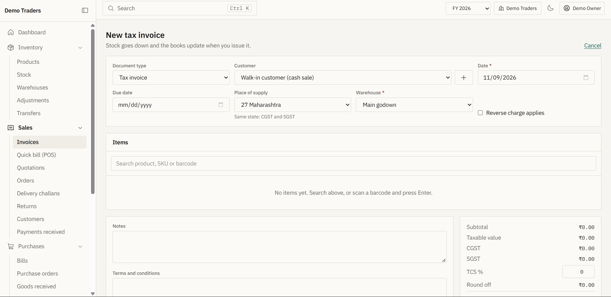

# Khata Books

Inventory, sales, purchases, GST invoices and accounting for Indian businesses. Next.js 16, TypeScript, Tailwind v4, Supabase.



Two data modes, switched by one environment variable:

- **demo** (default): the whole app runs on realistic sample data held in your browser. No account or backend needed.
- **supabase**: real auth, Postgres with row level security, and storage.

## Run it

```bash
npm install
npm run dev          # http://localhost:3000, opens in demo mode
```

Click "Open the demo business" on the sign in page.

## Connect Supabase

1. Create a Supabase project. Apply the SQL in `supabase/migrations/` in order (`supabase db push`, or paste each file into the SQL editor).
2. Copy `.env.example` to `.env.local` and fill in:
   ```
   NEXT_PUBLIC_DATA_MODE=supabase
   NEXT_PUBLIC_SUPABASE_URL=https://<project>.supabase.co
   NEXT_PUBLIC_SUPABASE_PUBLISHABLE_KEY=<publishable key>
   SUPABASE_SERVICE_ROLE_KEY=<service role key>   # server only, used to email team invitations
   ```
3. In Supabase Auth settings: set the minimum password length to 10 and require letters and digits, enable email confirmation, and turn on TOTP multi-factor authentication.
4. Regenerate types: `npx supabase gen types typescript --project-id <id> > src/lib/supabase/database.types.ts`.
5. Sign up in the app. The first user becomes the owner of their business.

## How it fits together

```
src/domain/     pure accounting engine: GST, double entry, stock, reports, permissions (no I/O)
src/data/       Repo interface, demo adapter (browser), Supabase adapter
src/features/   screens: inventory, documents (sales and purchases), parties, payments, accounting, dashboard, settings
src/components/ primitives, the 10 UI states, layout
src/lib/        gst, format (en-IN), validation (zod), security helpers, supabase clients
supabase/       migrations, seed helper, database tests
```

The same engine computes stock, tax and ledger postings in both modes. In Supabase mode the browser runs the engine on freshly loaded rows and sends the result to one RPC, `commit_changes`, which checks membership and permission, forces every row into the caller's business, and applies everything in a single transaction. The database enforces the invariants itself: composite foreign keys (no cross-tenant references), no negative stock, every journal entry balances, unique document numbers per financial year.

## Tests

```bash
npm run lint
npm run typecheck
npm run test         # unit tests plus database tests (migrations run in an in-process Postgres)
npm run build
npm run test:e2e     # needs the app running, uses installed Chrome
```

## Security checklist

| Item | Where |
| --- | --- |
| SQL injection | Only parameterised Supabase queries and RPC. No string-built SQL anywhere. |
| XSS | React escaping, no `dangerouslySetInnerHTML`, nonce-based CSP (`src/proxy.ts`). |
| CSRF | Server Actions (origin checked by Next) and SameSite cookies. |
| File uploads | Extension, MIME, size and magic-byte checks (`src/lib/security/upload.ts`); buckets enforce size and type again; documents bucket is private. |
| BOLA / IDOR | RLS on every table, composite `(business_id, id)` foreign keys, `commit_changes` forces `business_id`. Tested with two tenants. |
| Rate limiting | `src/proxy.ts` limits auth and mutation routes per IP. In-memory: use a shared store (Upstash, Vercel KV) when running several instances. Supabase Auth adds its own limits. |
| JWT and API secrets | Only in Supabase. The service role key is imported only from `server-only` modules. |
| Passwords | Supabase Auth (bcrypt). Client policy matches the server policy. |
| MFA | TOTP via Supabase (`/mfa`). |
| CORS | Same-origin only. No wildcard. |
| Tokens in storage | Sessions live in HTTP-only cookies via `@supabase/ssr`, never `localStorage`. |
| Server-side permissions | Role matrix in `src/domain/permissions.ts`, mirrored in SQL `has_permission`. A test asserts they agree for every role, module and action. |
| Webhooks | `src/lib/security/hmac.ts` (constant-time compare, replay window). |
| SSRF | No server fetch of user URLs. `src/lib/security/ssrf.ts` for any future need. |
| Source maps | `productionBrowserSourceMaps: false`. |
| Default credentials | None seeded. The first user creates the owner account. |
| Logs | `src/lib/security/redact.ts` strips tokens, emails and numbers. |
| Dependencies | Dependabot (`.github/dependabot.yml`) and `npm audit` in CI. |
| Headers | HSTS, X-Frame-Options, Referrer-Policy, Permissions-Policy, CSP. |

## Known limits

- E-invoice (IRN) and e-way bill generation need a GSP and are not connected. The IRN, acknowledgement and e-way bill number can be recorded by hand and print on the invoice.
- GSTR-1 and GSTR-3B are summaries for reference, not a filing-ready export. Cross-head ITC set-off is not modelled.
- Books use weighted average cost. FIFO value is shown on the stock report for comparison only.
- Excel export is CSV, which opens directly in Excel. PDF reports use the browser's Save as PDF.
- Logo and signature are stored as small data URLs in the business row. Product images and scanned bills use Storage.
- Terms of Service and Privacy Policy are templates. Have a lawyer review them and fill in the operator's details.
- The offline cache keeps recently opened lists on the device. Writes need a connection; unsent documents are saved as local drafts.
